# GroDoor — Hyperlocal On-Demand Product Delivery Platform

> A hyperlocal e-commerce concept that connects customers directly with nearby retail and grocery stores, letting them compare prices across shops and get products delivered fast.

**B.Tech Final Year Project · Computer Science & Engineering · Cooch Behar Government Engineering College (MAKAUT)**

`MERN` `Hyperlocal Commerce` `E-commerce` `Product Design` `Requirements Analysis` `UML` `Wireframing`

> [!NOTE]
> **About this repository**
> This project was developed as part of my **final year B.Tech project** at college. This repository is a **documentation and design showcase**: it presents the problem statement, scope, requirements, workflows and UI wireframes from the project report.
> The original implementation and source files are **not included here and cannot be disclosed or shared publicly**. Nothing in this repository should be read as a live product or a runnable codebase.

<p align="center">
  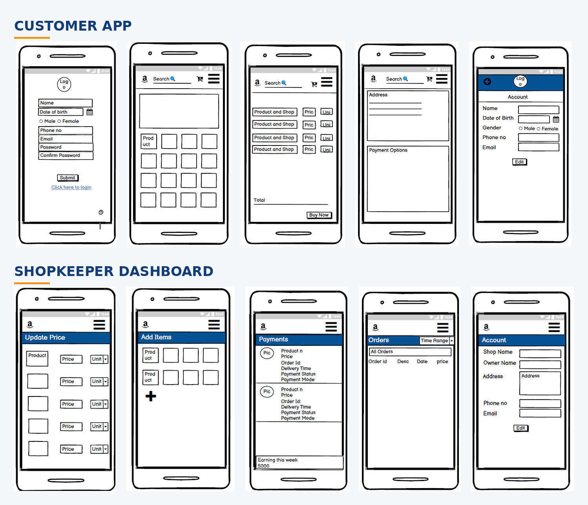
</p>

<p align="center"><em>Wireframes of the customer app (top) and shopkeeper dashboard (bottom)</em></p>

---

## Table of Contents

- [Overview](#overview)
- [Problem & Motivation](#problem--motivation)
- [Solution](#solution)
- [Key Features](#key-features)
- [System Overview](#system-overview)
- [UI Wireframes](#ui-wireframes)
- [Workflows](#workflows)
- [Functional Requirements](#functional-requirements)
- [Non-Functional Requirements](#non-functional-requirements)
- [Technology Stack](#technology-stack)
- [Assumptions](#assumptions)
- [Research & Methodology](#research--methodology)
- [Repository Contents](#repository-contents)
- [Team](#team)
- [Acknowledgements](#acknowledgements)
- [Usage & Disclaimer](#usage--disclaimer)

---

## Overview

**GroDoor** is a B2C hyperlocal on-demand delivery platform. Apps like Zomato and Swiggy transformed how restaurant food reaches customers; GroDoor applies the same idea to **local grocery and retail stores**, bridging the gap between neighbourhood shopkeepers and the consumers around them.

The platform has two primary sides:

- **Customer app** — discover nearby shops, compare prices, order and pay.
- **Shopkeeper dashboard** — manage inventory and prices, run offers, receive and track orders.

## Problem & Motivation

- As internet access and digital payments grow, more shoppers are moving online, creating a large e-commerce market.
- **Local retailers have been the main losers** of this shift, while large platforms capture the demand.
- People living in **apartments and flats**, or in areas with few grocery stores, often can't easily get everyday or emergency supplies without travelling.
- Customers have little visibility into **which nearby store offers the best price** for the same product.

## Solution

GroDoor detects the retail shops registered on the platform **within a set radius of the user's location** and shows the prices each shop offers. Customers can compare price and quality, pick a store and order. Because the stores are close by, delivery is fast. Shopkeepers gain a direct digital channel to reach customers in their locality.

> **Hyperlocal model:** the provider sources the requested product(s) locally and delivers them to a customer in the same geographical area.

## Key Features

### Customer

| Feature | Description |
|---|---|
| Registration & login | Register with name, date of birth, gender, email, mobile and password; **OTP and email verification** activate the account. Log in with mobile number or email plus password. |
| Nearby stores | View stores within a specified distance of the user's location. |
| Home | Dynamic page showing offers, categories, products and widgets. |
| Search | Keyword search for products and services. |
| Product description | Latest price, photos, and **ratings of each store selling the product**, with prices sortable per store to find the best deal. |
| Cart | Add multiple products and order them together. |
| Payment | Online (credit/debit card, wallets, net banking) or **Cash on Delivery**. |
| My Orders | Current and previous orders in one place. |
| Reviews & ratings | Rate and review a store after purchase (no rating without a purchase). |
| Notifications | Alerts for offers and delivery status. |
| Contact | Reach customer care and send feedback about product quality to stores. |
| Account | Manage address, phone number, pin code, email and more. |

### Shopkeeper

| Feature | Description |
|---|---|
| Registration & login | Register with shop name, owner name, address, contact details; OTP and email verification. |
| Update price panel | Change product prices as market rates move; updates are reflected to customers instantly. |
| Add items | Add new products to the shop's catalogue. |
| Recent & active orders | See orders from the last 3 days and all active orders awaiting delivery. |
| Order history | Browse the last 30 days of purchases. |
| Payments | Track payment status and records of payments received. |
| Add offers | Offer discounts on products or on total purchase value, shown on customers' dashboards. |
| Store view | Preview how the store appears on a customer's device and edit sections. |
| Account & contact | Edit shop details; contact support or administrators. |

### Admin

Manage users, create/update/delete catalogue items, add promo codes and offers, and surface top-rated stores.

## System Overview

The system is organised into three modules, as described in the project report:

1. **Web Ordering System** — customers create accounts, browse items, build an order, pay and receive an order number.
2. **Menu / Catalogue Management** — shop owners (admin-level users) add, update and delete items, prices, descriptions and photos.
3. **Order Retrieval** — shop staff retrieve new orders from the database and see them in an easy-to-read view.

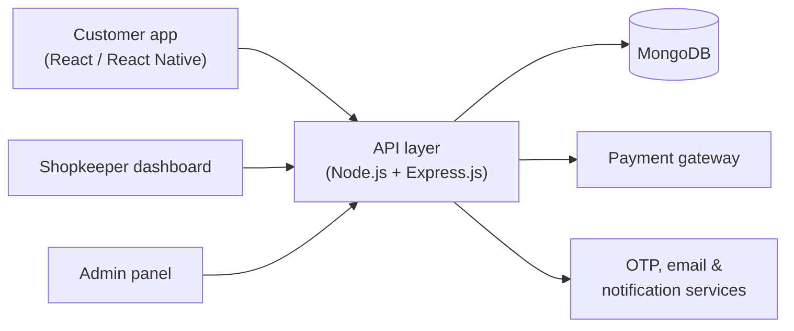

## UI Wireframes

Low-fidelity mobile wireframes designed with [Balsamiq](https://balsamiq.com/).

### Customer View

| Registration | Login | Home |
|:---:|:---:|:---:|
| 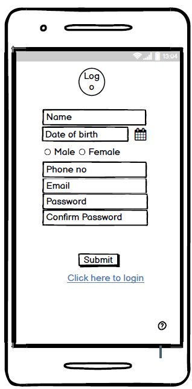 | 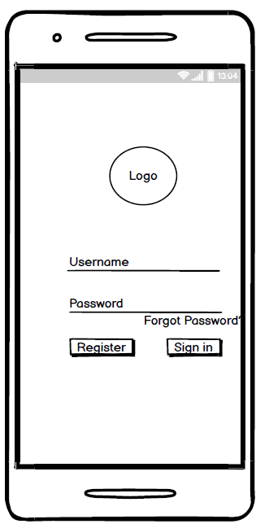 | 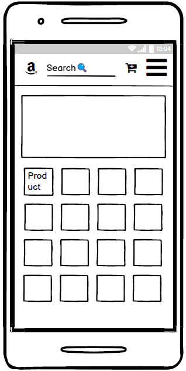 |

| Account | Cart | Payment |
|:---:|:---:|:---:|
| 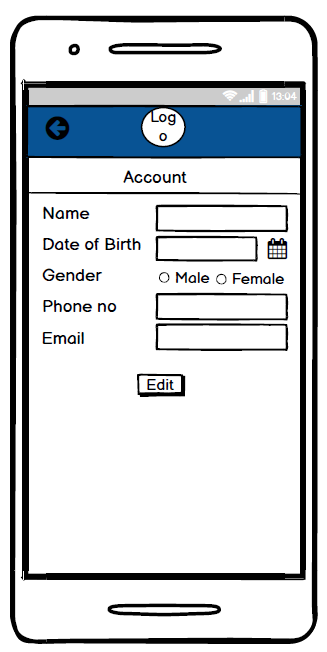 | 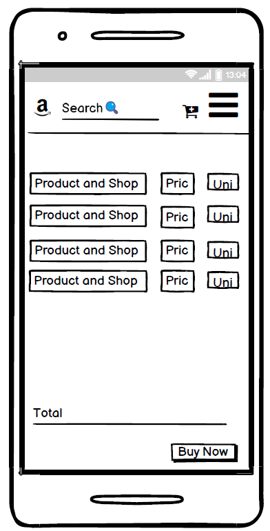 | 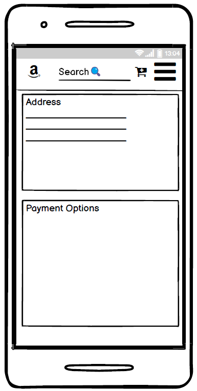 |

**My Orders**

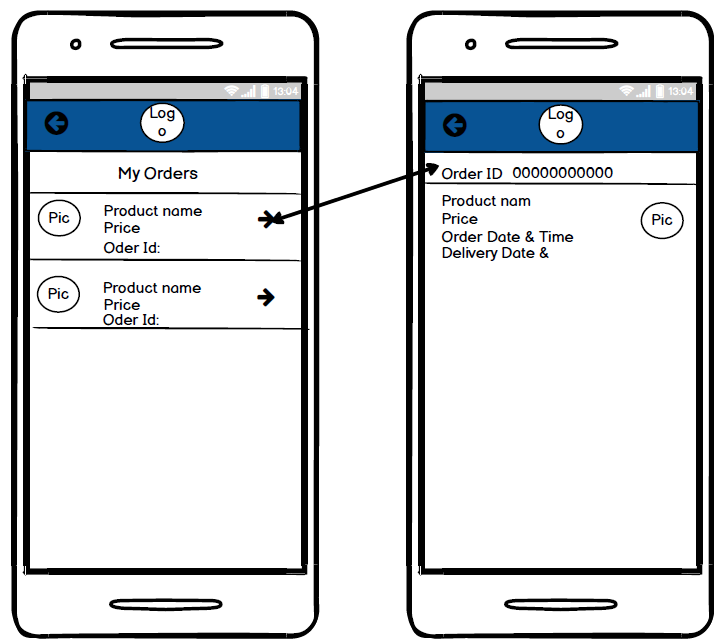

### Shopkeeper View

**Login & Registration**

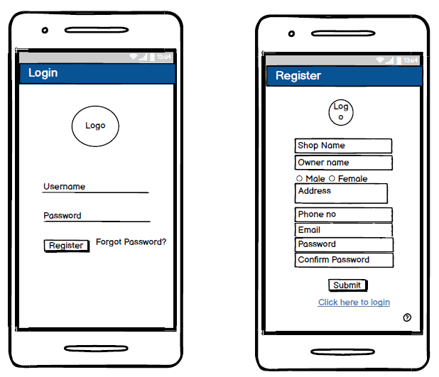

**Active/Recent Orders & Menu**

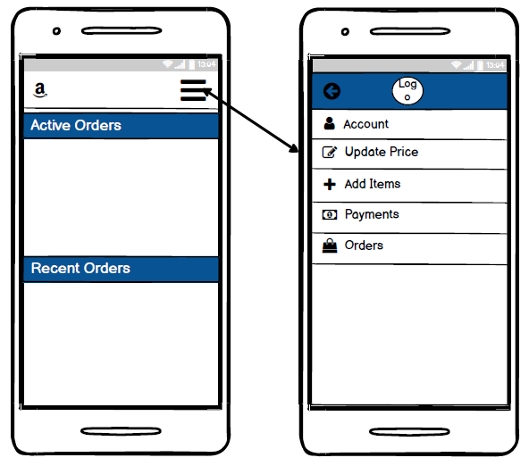

| Update Price | Add Items | Payments |
|:---:|:---:|:---:|
| 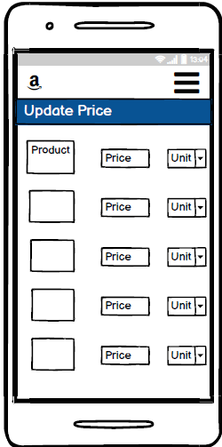 | 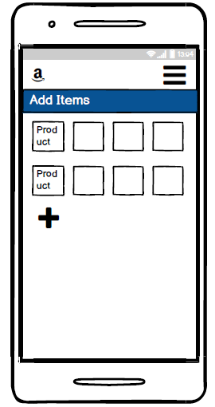 | 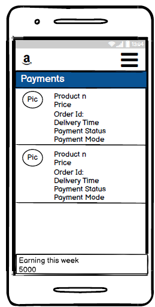 |

| Order History | Account |
|:---:|:---:|
| 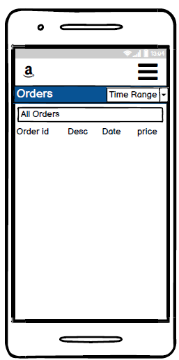 | 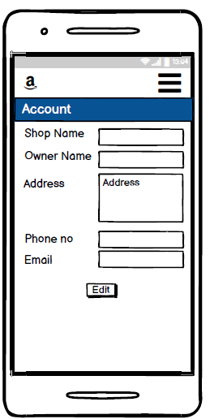 |

## Workflows

Workflow diagrams were created in Lucidchart.

### Login & Registration

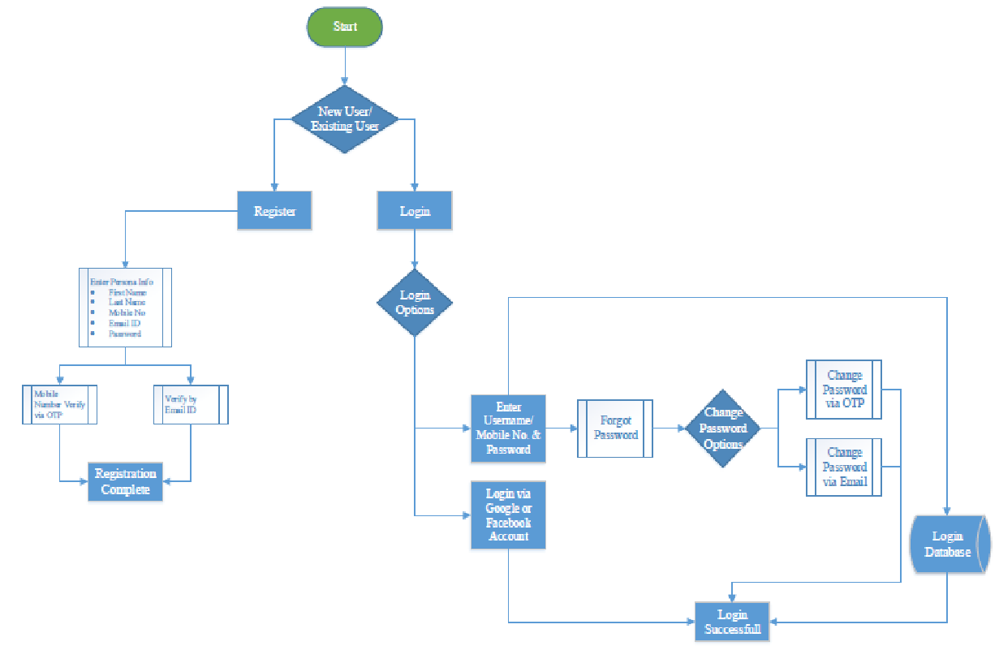

### Order Placement

From selecting an item to order confirmation.

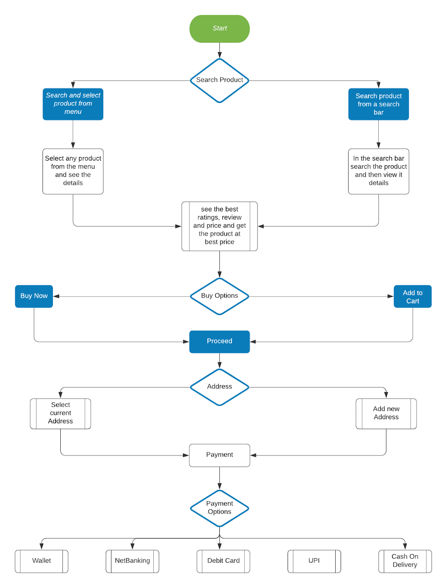

## Functional Requirements

Requirements are grouped by user role. The full report defines 24 numbered requirements (R1–R24).

### Customer

- **R1** Log in, or skip registration to enter the dashboard
- **R2** View nearby retail stores within a specified distance
- **R3** Choose a preferred store to order from
- **R4** Order items and add them to the cart
- **R5** View the menu and search for desired products
- **R6** Remove items from the cart
- **R7** Finalise payment in cash from the billing view
- **R8** Navigate between menu and cart, adding items
- **R9** Pay by bank card through a payment gateway
- **R10** Apply offers provided by the store
- **R11** Rate product quality and service
- **R22** Fetch sorted prices with store names on the product page to get the best price
- **R24** Ratings only allowed for stores the customer has purchased from

### Retailer

- **R12** Create, read, update and delete items from the menu
- **R13** View orders placed by customers
- **R14** Receive orders from customers
- **R15** View payments
- **R16** Create offers
- **R21** See weekly and monthly sales
- **R23** Act on customer feedback and reviews to improve service

### Admin

- **R17** Manage users
- **R18** Create, read, update and delete catalogue items
- **R19** Display top-rated retail stores
- **R20** Add promo codes and offers

## Non-Functional Requirements

Quality attributes the system is specified to meet:

| Area | Intent |
|---|---|
| Security & privacy | Defined security level; basic GDPR requirements |
| Scalability & performance | Scale to expected normal and peak traffic and order volume |
| Speed & search | Defined response times for web services and search |
| Availability | Agreed uptime under normal conditions |
| Infrastructure | CPU and memory usage thresholds |
| Accessibility | Meet basic accessibility standards |
| Quality, testing & documentation | Good code quality, built-in unit testing, sufficient documentation |
| Extensibility & compatibility | Easy future development and 3rd-party integration |
| Data integrity & retention | Defined data retention and integrity rules |

## Technology Stack

As specified in the project report:

| Layer | Technology |
|---|---|
| Web front-end | React.js |
| Back-end | Node.js, Express.js |
| Database | MongoDB |
| Mobile (planned) | React Native (Android / iOS) |
| Design & diagrams | Balsamiq (wireframes), Lucidchart (workflows), Microsoft Word (UML / use cases) |

The application is required to be fully usable on the web and responsive on mobile devices.

## Assumptions

- The list of shops registered on the platform is shown to the user in the app.
- Product details and images are uploaded by merchants.
- Ratings and reviews for quality and service come from customers and are shown in the app.
- Discounts and offers are provided by shop owners.
- Terms and conditions are provided by a legal team.
- Customers have a way to submit feedback or queries about products.

## Research & Methodology

The concept was shaped through:

- Studying existing B2B/B2C platforms and apps such as Grofers, Swiggy, Zomato, BigBasket and UberEats.
- **Local surveys of retail stores** to understand usage and demand.
- **Surveys of people living in apartments and flats** to understand their needs.
- Reading industry blogs on hyperlocal on-demand delivery models.
- Regular consultation with the project mentor and peers.

## Repository Contents

```
.
├── README.md
└── assets/
    ├── hero-wireframes.png  # Banner collage used at the top of this README
    ├── wireframes/   # Customer and shopkeeper mobile wireframes
    └── diagrams/     # Login/registration and order placement workflows
```

## Team

Final year B.Tech CSE project team:

- **Ayush Gupta**
- **Khokan Paul**
- **Kazi Mehebub Rahaman**
- **Shubham Bose**

**Project guide:** Prof. Somen Mondal, Assistant Professor, Cooch Behar Government Engineering College

## Acknowledgements

Thanks to Prof. Somen Mondal for his guidance and constant encouragement, to the Department of Computer Science and Engineering at Cooch Behar Government Engineering College, and to the shopkeepers and residents who shared feedback during our surveys.

## Usage & Disclaimer

This repository was created for **portfolio and educational viewing only**. The wireframes and diagrams are from the final year project report. The original source code and technical files are not part of this repository and cannot be disclosed. Please do not reuse or redistribute the contents without permission from the authors.
